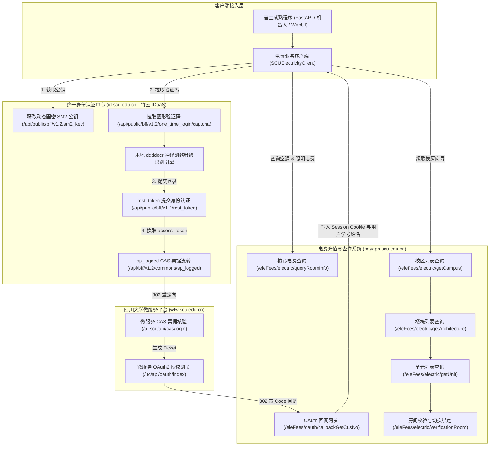

# 四川大学宿舍电费系统 (SCU Electricity) — 架构解析与后端集成说明书

本文档用于完整记录**四川大学宿舍电费查询与充值系统（`payapp.scu.edu.cn`）**及其所依附的**四川大学统一身份认证中心（`id.scu.edu.cn`，竹云 IDaaS）**的技术架构、通信协议、接口规范与工程集成方案，供后续将该能力无缝整合至现有成熟后端服务（如 FastAPI / Flask / 校园微服务 / 机器人助手）中。

---

## 1. 系统业务与网络拓扑全景

四川大学宿舍电费系统并非独立的开放接口系统，而是挂载在四川大学微服务平台下、由竹云 IDaaS 统一身份认证提供 CAS 2.0 / OAuth2 级联单点登录保护的 Web 应用。



---

## 2. 统一身份认证与单点登录技术规范

四川大学统一身份认证基于**竹云 IDaaS (BAMBOOCLOUD IDaaS)**，租户标识为 `scdx`。

### 2.1 获取动态 SM2 密钥
* **接口地址**：`POST https://id.scu.edu.cn/api/public/bff/v1.2/sm2_key`
* **请求头**：`Content-Type: application/json`, `Referer: https://id.scu.edu.cn/frontend/login`
* **请求体**：`{}`
* **响应示例**：
  ```json
  {
    "success": true,
    "code": "200",
    "data": {
      "code": "53526c83aa6bac2fbe48f2c0b9e4c97a0FuTceFr7dj",
      "publicKey": "BGO0RNF6eN8ljLHen0FVycn/s5rfsxgQhYeRr3vhNFMj4o5Ra6rr0LQmKnqQytLjhBDomx0piPgUi0tpK2ZBu6g="
    }
  }
  ```

### 2.2 密码加密算法规范 (国密 SM2)
竹云 IDaaS 前端采用标准国密 SM2 算法进行非对称加密：
* **加密模式**：`C1C2C3` 模式（旧国密标准，`mode=0`）
* **公钥处理**：将 Base64 格式的公钥解码为 130 字符 Hex（`04 + X + Y`，非压缩公钥）
* **前缀处理**：`gmssl.sm2.CryptSM2.encrypt` 默认返回 `c1`（64字节无04）+ `c2` + `c3`。竹云后端要求密文必须包含 `04` 前缀，若输出不以 `\x04` 开头，需在字节流头部添加 `b"\x04"`
* **最终密文**：Base64 编码的 ASCII 字符串

### 2.3 图形验证码拉取与本地识别
* **接口地址**：`GET https://id.scu.edu.cn/api/public/bff/v1.2/one_time_login/captcha?enterpriseId=scdx`
* **响应示例**：
  ```json
  {
    "success": true,
    "code": "200",
    "data": {
      "code": "5b8859070091ba00bfc707b82ce3e8e4zd1Me3wRBGT",
      "captcha": "iVBORw0KGgoAAAANSUhEUgAAAFAAAAAaCAIAAACvsEzw..."
    }
  }
  ```
* **识别方案**：利用 Python 本地轻量神经网络识别库 `ddddocr`，直接解码 Base64 图片传入识别，识别成功率达 99% 以上，毫秒级响应。

### 2.4 提交身份认证并换取 `access_token`
* **接口地址**：`POST https://id.scu.edu.cn/api/public/bff/v1.2/rest_token`
* **请求体 (JSON)**：
  ```json
  {
    "client_id": "1371cbeda563697537f28d99b4744a973uDKtgYqL5B",
    "grant_type": "password",
    "scope": "read",
    "username": "<学号>",
    "password": "<SM2加密后的Base64密文>",
    "_enterprise_id": "scdx",
    "sm2_code": "<sm2_key返回的code>",
    "cap_code": "<captcha返回的code>",
    "cap_text": "<OCR识别出的4位文本>",
    "deviceId": ""
  }
  ```
* **认证成功响应**：
  ```json
  {
    "code": "200",
    "data": {
      "access_token": "f4b0051e-62aa-4fbe-9076-xxxxxxxxxxxx",
      "token_type": "bearer",
      "expires_in": 7199
    }
  }
  ```

### 2.5 CAS 票据流转与 Cookie 写入
拿到 `access_token` 后，携带初始化认证链中捕捉到的 `sp_code` 与 `application_key`，访问 CAS 回跳网关：
```python
sp_url = (
    f"https://id.scu.edu.cn/api/bff/v1.2/commons/sp_logged"
    f"?sp_code={urllib.parse.quote(sp_code)}"
    f"&application_key={application_key}"
    f"&access_token={access_token}"
)
```
开启 `allow_redirects=True`，HTTP 客户端会自动跟随多级 302 重定向：
1. `id.scu.edu.cn` 验证 `access_token` 并生成 CAS Ticket 回跳微服务平台
2. `wfw.scu.edu.cn` 接收 Ticket 校验并签发 OAuth Code
3. 最终落回到 `https://payapp.scu.edu.cn/eleFees/oauth/callbackGetCusNo?code=...`
4. 服务端在响应中写入关键 Cookie（如 `JSESSIONID`、`eai-sess` 等），并在页面 HTML 内渲染注入当前用户的凭据：
   * `var cusNo = '学号'`
   * `var cusName = '姓名'`
   * `var type = '1'`

---

## 3. 电费核心业务 API 规范

所有电费业务接口前缀为 `https://payapp.scu.edu.cn/eleFees`，均为 `POST` 请求，数据格式为 `application/json`，必须携带已认证有效的会话 Cookie。

### 3.1 查询当前宿舍电费（核心接口）
* **路径**：`POST /electric/queryRoomInfo`
* **请求入参**：
  ```json
  {
    "cusNo": "2024141470117",
    "type": 1,
    "cusName": "白镇萍"
  }
  ```
  > `type`: `1` 为空调电费；`2` 为照明电费。
* **响应数据 (成功)**：
  ```json
  {
    "respCode": "00",
    "respDesc": "成功",
    "data": {
      "schoolName": "江安校区",
      "regName": "西园15舍",
      "unitName": "10单元",
      "roomNo": "101c",
      "price": "0.5464",
      "balance": "34.73",
      "cusNo": "2024141470117"
    }
  }
  ```
* **字段说明**：
  * `balance`: 剩余可用电量（度）
  * `price`: 电费单价（元/度）
  * `schoolName`: 校区名称
  * `regName`: 宿舍楼栋名称
  * `unitName`: 单元编号（若无单元则为 `null`）
  * `roomNo`: 房间编号（含子房间字母，如 `101c`）

### 3.2 校区列表查询
* **路径**：`POST /electric/getCampus`
* **请求入参**：`{}`
* **响应示例**：
  ```json
  {
    "respCode": "00",
    "respDesc": "成功",
    "data": {
      "datas": [
        { "name": "望江校区", "code": "1" },
        { "name": "华西校区", "code": "2" },
        { "name": "江安校区", "code": "3" }
      ]
    }
  }
  ```

### 3.3 楼栋列表查询
* **路径**：`POST /electric/getArchitecture`
* **请求入参**：
  ```json
  {
    "schoolCode": "3"
  }
  ```
* **响应示例**：
  ```json
  {
    "respCode": "00",
    "respDesc": "成功",
    "data": {
      "datas": [
        { "name": "东园1舍", "code": "101" },
        { "name": "西园15舍", "code": "315" }
      ]
    }
  }
  ```

### 3.4 单元列表查询
* **路径**：`POST /electric/getUnit`
* **请求入参**：
  ```json
  {
    "schoolCode": "3",
    "regCode": "315"
  }
  ```
* **响应示例**：
  ```json
  {
    "respCode": "00",
    "respDesc": "成功",
    "data": {
      "datas": [
        { "name": "1单元", "code": "01" },
        { "name": "10单元", "code": "10" }
      ]
    }
  }
  ```
  > 若该楼栋无单元划分（如望江老楼），`datas` 返回空数组 `[]`。

### 3.5 房间校验与切换绑定
* **路径**：`POST /electric/verificationRoom`
* **请求入参**：
  ```json
  {
    "cusNo": "2024141470117",
    "type": 1,
    "cusName": "白镇萍",
    "schoolCode": "3",
    "regCode": "315",
    "unitCode": "10",
    "roomNo": "101c"
  }
  ```
* **响应示例**：
  ```json
  {
    "respCode": "00",
    "respDesc": "成功",
    "data": {
      "status": true,
      "desc": "成功"
    }
  }
  ```
  > 验证成功后，电费系统在当前用户会话上立即绑定该房间。紧接着调用 `queryRoomInfo` 即可查询新房间的最新电量。

---

## 4. 融入成熟后端的工程化架构建议

为了将本功能优雅地合并到成熟程序（如基于 FastAPI / Flask 的现有服务）中，推荐采用**分层服务架构**：

```
server/
├── services/
│   ├── scu_auth_service.py       # 负责竹云 IDaaS 统一身份认证、SM2加密、验证码与会话保活
│   └── scu_electricity_service.py# 负责电费查询、双类型电量聚合、换房级联业务
├── routers/
│   └── electricity.py            # 对外暴露 RESTful API (供前端/小程序/机器人调用)
└── data/
    └── ele_session.json          # 缓存持久化 (生产环境可替换为 Redis 或数据库)
```

### 推荐的对外 REST API 设计

| 请求方法 | 路由路径 | 说明 |
| :--- | :--- | :--- |
| `POST` | `/api/electricity/login` | 传入学号与密码，完成自动验证码识别登录并建立会话 |
| `GET` | `/api/electricity/status` | 获取当前宿舍电费（同时返回空调与照明度数、单价、房间名） |
| `GET` | `/api/electricity/campuses` | 获取校区列表 |
| `GET` | `/api/electricity/buildings` | 根据 `school_code` 获取楼栋列表 |
| `GET` | `/api/electricity/units` | 根据 `school_code` 和 `reg_code` 获取单元列表 |
| `POST` | `/api/electricity/switch_room`| 传入校区、楼栋、单元、房间号，执行一键切换绑定 |

### 核心 Python 依赖
```txt
requests>=2.32.0
gmssl>=3.2.2
ddddocr>=1.5.6
```

---

## 5. 关键踩坑与避坑指南

1. **终端输入密码无回显**：Windows 原生命令行中 `getpass` 属于静默输入，远程连接时易被误解为卡死。若在命令行交互环境中使用，务必使用 `msvcrt` 做星号实时回显。若做成 Web/API 服务，直接由前端表单传输密码。
2. **二维码协议属性**：竹云 IDaaS 的移动端二维码为私有协议（`one_time_login`），只能用“智慧川大 APP”扫码，不支持微信开放平台扫码。自动化程序应首选**账号密码 + SM2 + ddddocr** 方案。
3. **参数不可为空**：`queryRoomInfo` 和 `verificationRoom` 对 `cusNo` 有强制校验要求，若直接访问 `/air/home` 模版页面，`cusNo` 为空会导致服务端返回 `respCode: 99`（参数不全），必须通过单点登录重定向回调链路获取真实绑定的 `cusNo`。
4. **安全判空规范**：当接口报错（如参数错误或房间不存在）时，服务端的 `data` 字段为 `null`（在 Python 中解析为 `None`）。在代码中应始终采用 `data = resp.get("data") or {}`，避免出现 `'NoneType' object has no attribute 'get'`。
