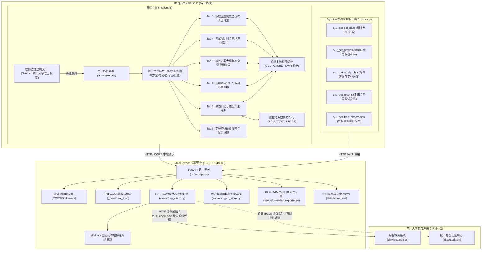

# DeepSeek Harness 四川大学教务系统 (URP) 插件 — 项目架构与工程说明书

本文档用于完整记录本项目的**技术架构、工程目录组织、核心模块实现、关键文件路径清单、前后端数据流转、接口清单、图标设计规范及分支版本体系**，便于长期维护与二次开发。

---

## 1. 项目概览

本项目是专为 **DeepSeek Harness (DSH)** 深度打造的四川大学综合教务系统（URP）全功能集成插件，具备两大核心能力：

1. **左侧全局面板与主工作区看板 (Client UI)**：
   - 遵循 DSH 官方 `dsh-plugin-guide.md` 标准，挂载至左侧全局面板列表（`sidebar.panellist`），采用**四川大学官方精美矢量校徽**作为主图标，点击后在主工作区（`main` 插槽）以沉浸式宽屏面板展现。
   - 包含六大核心模块：**课表与随堂待办**、**成绩绩点与保研分析**、**培养方案全景大纲与均分测算模拟器**、**考试安排倒计时**、**多校区空闲教室与考研自习室**、**账号凭据与全自动保活设置**。
   - 视觉规范：极简莫兰迪色系、单色镂空简笔画 SVG 图标（Feather 规范）、四川大学官方矢量校徽，无大红大绿杂色，深度自适应 DSH 亮暗主题。
2. **对话式 Agent 智能工具链 (Cordis Tools)**：
   - 向宿主大模型安全注册 5 大核心学业工具（查课表、查成绩、查考场、查自习室、查培养方案与学业进展）。学生在任意主对话窗口中输入自然语言，AI 助手即可调用本地工具精准感知并给出专业学业建议。

---

## 2. 系统整体架构

---

## 3. 关键文件与工程组织

| 模块类别 | 文件名与绝对链接 | 语言/规范 | 核心职责说明 |
| :--- | :--- | :---: | :--- |
| **插件主控** | [index.js](file:///d:/antigravaty/scu教务处/index.js) | JavaScript | 遵循 Cordis 规范：托管启动本地 Python 服务，向 LLM 注册 5 大自然语言工具 |
| **前端看板** | [client.js](file:///d:/antigravaty/scu教务处/client.js) | JavaScript (React) | 单文件纯前端架构：内置四川大学官方矢量校徽 `ScuIcon`、六大视图、SWR 极速秒开、What-If 均分模拟测算 |
| **官方图标** | [icon.svg](file:///d:/antigravaty/scu教务处/icon.svg) | SVG 矢量 | 四川大学官方精美矢量校徽（单色设计，自适应深浅色，170×170） |
| **后端网关** | [server/app.py](file:///d:/antigravaty/scu教务处/server/app.py) | Python (FastAPI) | 本地 HTTP 网关（48080 端口）、CORS 中间件、多模态认证路由、10 分钟双系统保活聚合 |
| **认证中枢** | [server/auth_hub.py](file:///d:/antigravaty/scu教务处/server/auth_hub.py) | Python | 四川大学竹云 IDaaS 统一身份认证中枢：国密 SM2 自动过验证码登录、动态扫码、URP 与电费双向会话无缝派发 |
| **电费客户端** | [server/ele_client.py](file:///d:/antigravaty/scu教务处/server/ele_client.py) | Python | 四川大学宿舍电费 API 客户端：空调/照明双电量聚合、校区/楼栋/单元/房间层级字典与换房绑定 |
| **教务协议** | [server/urp_client.py](file:///d:/antigravaty/scu教务处/server/urp_client.py) | Python | 四川大学综合教务处底层接口通信、加盐双重 MD5 密码哈希、验证码识别、课表/成绩/培养方案抓取解析 |
| **硬件加密** | [server/crypto_store.py](file:///d:/antigravaty/scu教务处/server/crypto_store.py) | Python (Fernet) | 提取本设备硬件特征（UUID + 计算机名）加盐哈希作为密钥，对学号、密码与 Session 进行对称加密持久化 |
| **日历导出** | [server/calendar_exporter.py](file:///d:/antigravaty/scu教务处/server/calendar_exporter.py) | Python | RFC 5545 标准 iCalendar (.ics) 日历导出，区分江安与望江作息，注入课前 15 分钟提前提醒闹钟 |
| **待办持久化** | [data/todos.json](file:///d:/antigravaty/scu教务处/data/todos.json) | JSON | 课程随堂作业、实验报告、备忘事项的双向持久化存储文件 |
| **依赖清单** | [server/requirements.txt](file:///d:/antigravaty/scu教务处/server/requirements.txt) | 文本 | 后端必备依赖（fastapi, uvicorn, requests, ddddocr, cryptography 等） |
| **包清单声明** | [package.json](file:///d:/antigravaty/scu教务处/package.json) | JSON | DSH 插件清单规范：声明包名称、入口文件、`icon: "./icon.svg"` 顶层图标与 `./icon` 导出映射 |
| **补丁配置** | [cordis.patch.yml](file:///d:/antigravaty/scu教务处/cordis.patch.yml) | YAML | Cordis 容器层服务补丁与插件作用域配置 |
| **启动脚本** | [start.bat](file:///d:/antigravaty/scu教务处/start.bat) | Windows 批处理 | Windows 环境下自动探测 Python 3.12 解释器并一键启动后端服务 |
| **架构文档** | [PROJECT_STRUCTURE.md](file:///d:/antigravaty/scu教务处/PROJECT_STRUCTURE.md) | Markdown | 本文档：项目全套架构、已完成模块、关键路径与后续演进清单 |
| **接口手册** | [URP_API_SPEC.md](file:///d:/antigravaty/scu教务处/URP_API_SPEC.md) | Markdown | 四川大学综合教务处底层的原始逆向接口与字段对照手册 |

---

## 4. 七大核心业务模块功能详解

### 4.1 课表模块 (`ScheduleView`) 与手机日历导出
- **周网格与清单双视图**：
  - 支持“全学期（全部周次）”以及第 1~20 教学周动态切换；
  - 自动根据当前系统星期与节次高亮今日课程，并在卡片上标出进行中/下一节课；
  - 自动识别并归纳未排定具体时间的地学实习、线上网课、讨论课至专属卡片。
- **川大官方作息时间对齐**：
  - 严格匹配四川大学教务处官网作息时间表，区分**江安校区**（第 1 节 08:15 开始）与**望江/华西校区**（第 1 节 08:00 开始）；
  - 课程弹窗内精准展示作息起止时间（如 `08:15 ~ 09:55`）。
- **标准手机日历导出 ([server/calendar_exporter.py](file:///d:/antigravaty/scu教务处/server/calendar_exporter.py))**：
  - 一键导出标准 `.ics` 文件，可在 iOS 日历、小米/华为/OPPO/vivo、Google Calendar 中直接导入；
  - 包含课前 15 分钟闹钟提醒、任课教师、校区、教学楼、具体教室。

### 4.2 课程随堂作业与备忘待办系统 (`SCU_TODO_STORE`)
- **双轨持久化**：前端 `localStorage` 与本地后端 [data/todos.json](file:///d:/antigravaty/scu教务处/data/todos.json) 实时双向同步，确保重启电脑或重载插件数据不丢失。
- **课程卡片动态角标**：在网格视图和列表视图的课程卡片右上角，若有未完成作业，自动呈现红底徽章（如 `1待办`）。
- **随堂记录与全学期总览**：
  - 点击单门课程弹窗可直接添加、勾选完成（打勾加中划线）与删除作业；
  - 顶部常驻“作业待办”抽屉按钮，支持按“全部 / 待完成 / 已完成”进行统一总览。

### 4.3 成绩绩点看板与保研必修加权分析 (`GradesView`)
- **自动折算加权 GPA**：自动提取历史全量出分，支持等级制（A/A-/B+...）与百分制双轨自动换算。
- **保研必修分项切换**：一键在“全部成绩”与“必修成绩（保研标准）”之间无缝切换，实时重新计算加权平均分与加权 GPA。
- **CSV 成绩单导出**：支持一键导出标准格式的成绩单 CSV 文件，便于个人归档。

### 4.4 培养方案全景大纲与未来均分/GPA预测模拟器 (`StudyPlanView`)
- **官方培养方案树对齐**：
  - 自动抓取教务处官方专业培养方案，清晰标注毕业要求总学分（如 165.0 学分）与当前已修学分百分比动态进度条。
- **已修 / 修读中 / 未修三态课程梳理**：
  - **已修课程**：支持勾选“假设刷分”，模拟重修对总均分的提分效果；
  - **修读中课程**：默认纳入模拟模型，提供数字输入与微型 Slider 滑块实时调分；
  - **未修课程**：展示大三、大四待修大纲，支持一键“+ 加入模拟”并设定预期成绩。
- **双轨加权均分与 GPA 实时计算引擎 (What-If Engine)**：
  - 动态计算未来预期总加权均分、保研必修均分与综合 GPA；
  - 实时显示相比当前基准的变动幅度徽章（如 `+0.35` / `-0.12`）。

### 4.5 考试日程倒计时 (`ExamsView`)
- 自动提取期末与阶段性考试日程，计算距今剩余倒计时天数；
- 完整显示考试校区、教学楼、具体考场及个人座位号。

### 4.6 多校区空闲教室与考研自习室 (`ClassroomsView`)
- **三校区自适应作息**：望江校区、江安校区、华西校区教学楼字典与时间自适应。
- **多维图形化筛选**：
  - 4 个大时段 Pill：全天 (1~12节)、上午 (1~4节)、下午 (5~9节)、晚上 (10~12节)；
  - 12 个微型双行时间胶囊（节次 + 时钟区间），带当前实时进行中小节虚线标识；
  - 快速过滤空调研讨配置、全天空闲；提供 1~12 节全天占用矩阵色条。

### 4.7 账号凭据加盐加密与全天保活 (`SettingsView`)
- **技术探查结论**：四川大学统一身份认证中心（`id.scu.edu.cn`）采用竹云 IDaaS 私有协议，移动端二维码仅供官方【智慧川大 APP】内部扫码，未开放公共微信扫码协议。
- **最佳接入设计**：
  - 学号与密码输入一次后，通过 [server/crypto_store.py](file:///d:/antigravaty/scu教务处/server/crypto_store.py) 基于本设备硬件特征加盐对称加密存储；
  - 后端常驻 `_heartbeat_loop` 协程每 10 分钟发送探针保活，断线自动静默重连，首屏 **0 毫秒静默开箱即用**。

### 4.8 宿舍电费实时查询与换房向导 (`ElectricityView`)
- **纯白极简双模电费卡片**：
  - 纯白悬浮极简卡片，左侧【空调动力用电】、右侧【宿舍照明用电】；
  - 38px 醒目大字号展示剩余可用电量（度），依据基准电价（0.5464 元/度）实时折算预估余额；
  - 智能电量预警：低于 10 度时自动切换为柔和红色预警状态（防止夜间断电），正常时呈现绿色充足状态。
- **当前绑定宿舍概览 Banner**：
  - 顶部自动呈现当前绑定的校区、楼栋、单元、房间号及身份学号；
  - 支持一键无感刷新拉取最新读数，记录精确刷新时间戳。
- **三级级联换房向导弹窗**：
  - 望江、华西、江安三校区楼栋层级字典自动联动拉取；
  - 智能识别单元配置，输入房间号一键校验并切换绑定，秒级生效。
- **官方微服务充值通道指引**：
  - 清晰指引【微川大】服务号一卡通购电与【智慧川大 APP】线上充值方式。

---

## 5. 后端 RESTful 接口清单 (127.0.0.1:48080)

| 路径 | 方法 | 职责说明 | 请求/返回格式 |
| :--- | :---: | :--- | :--- |
| `/api/status` | GET | 查询本地服务健康状态、统一认证态与各子系统登录态 | 返回 `{ status, hasCredentials, authType, username, isLoggedIn, studentName, electricity }` |
| `/api/auth/login` | POST | 统一身份认证登录 (默认 unified_sso，可选 legacy_urp) | Body: `{ username, password, authType, remember }` |
| `/api/auth/qrcode/new` | GET | 获取竹云 IDaaS 动态二维码 (微川大/智慧川大扫码) | 返回 `{ code, qrcode, expiresIn }` |
| `/api/auth/qrcode/status` | GET | 轮询统一认证扫码状态，扫码通过后自动打通教务与电费 | Query: `code` |
| `/api/electricity/status` | GET | 自动复用统一凭据免密查询当前宿舍空调与照明电费 | 返回 `{ success, air, light, roomDisplay, cusNo, cusName }` |
| `/api/electricity/campuses` | GET | 获取宿舍电费校区列表 (望江、华西、江安) | 返回 `{ campuses: [...] }` |
| `/api/electricity/buildings` | GET | 根据校区代码获取楼栋字典列表 | Query: `schoolCode` |
| `/api/electricity/units` | GET | 根据校区与楼栋代码获取单元字典列表 | Query: `schoolCode`, `regCode` |
| `/api/electricity/verify-room` | POST | 校验并一键切换绑定宿舍房间 | Body: `{ schoolCode, regCode, unitCode, roomNo }` |
| `/api/login` | POST | 兼容旧版登录入口 (自动重定向至多模态认证) | Body: `{ username, password, remember }` |
| `/api/logout` | POST | 清除本地保存的凭据与各系统 Session | 返回 `{ success, message }` |
| `/api/schedule` | GET | 获取当前学期全量课表与教学周分布 | 返回 `{ semesterId, totalCourses, courses: [...] }` |
| `/api/grades` | GET | 获取全量成绩、各学期统计与加权 GPA | 返回 `{ grades, terms, termStats, totalCredits, gpa }` |
| `/api/program/scheme` | GET | 获取官方培养方案、学分完成度与课程大纲 | 返回 `{ programName, requiredTotalCredits, completedCourses, inProgressCourses, pendingCourses, baseStats }` |
| `/api/exams` | GET | 获取已排定的期末/阶段考试日程 | 返回 `{ exams: [...] }` |
| `/api/schedule/export-ics` | GET | 导出全学期课表为 RFC 5545 .ics 日历 | Query: `startMonday`, `alarmMinutes`, `campus` |
| `/api/grades/export-csv` | GET | 导出成绩单为 CSV/Excel 文件 | Query: `onlyRequired`, `download` |
| `/api/classrooms/buildings` | GET | 获取各校区自习教学楼字典列表 | 返回 `{ campuses, buildings }` |
| `/api/classrooms/free` | GET | 查询指定楼栋、日期、时段空闲教室与 1~12 节矩阵 | Query: `campus`, `building`, `date`, `session`, `timeSlot`, `minCapacity` |
| `/api/todos` | GET | 读取本地所有课程随堂备忘与作业待办 | 返回 `{ todos: [...] }` |
| `/api/todos` | POST | 批量保存更新随堂备忘与作业待办 | Body: `{ todos: [...] }` |

---

## 6. 对话 Agent 自然语言智能工具链 (Cordis Tools)

向 DeepSeek Harness 主对话注册了 7 个核心工具，让 AI 具备直接感知学业与校园生活数据的能力：

1. `scu_get_schedule`:
   - 描述：查询四川大学当前学期课程表或今日日程。
   - 参数：`filterToday` (是否仅查询今日日程)。
2. `scu_get_grades`:
   - 描述：查询课程成绩、各学期加权平均分及综合 GPA。
   - 参数：`term` (学期), `onlyRequired` (是否仅统计保研必修课)。
3. `scu_get_study_plan`:
   - 描述：查询学生当前专业培养方案执行进度、毕业要求总学分、已修学分、在读课程与待修课程大纲。
   - 参数：无。
4. `scu_get_exams`:
   - 描述：查询期末与阶段性考试安排、考试时间、校区、考场与座位号。
   - 参数：无。
5. `scu_get_free_classrooms`:
   - 描述：查询四川大学望江、江安、华西校区空闲自习教室与考研教室。
   - 参数：`campus` (校区), `building` (教学楼), `date` (日期), `session` (节次), `timeSlot` (时段)。
6. `scu_export_calendar`:
   - 描述：将全学期课表导出为标准手机日历文件 (.ics / iCalendar 格式)。
   - 参数：`startDate` (开学周一日期), `alarmMinutes` (提前提醒分钟数)。
7. `scu_get_electricity`:
   - 描述：查询当前绑定宿舍的实时电费账单（空调与照明电量、预估余额、单价及房间位置）。
   - 参数：无。

---

## 7. 分支管理与版本体系 (Git Branches)

| 分支名 | 当前状态 | 定位与说明 |
| :--- | :---: | :--- |
| **`feature/new-ele-plan`** | **当前所在分支** | 新方案开发专属分支。基于电费系统制作之前的纯净节点建立，完全剔除了旧版电费系统的实验代码与网络依赖，保留了四川大学官方精美矢量校徽优化，工作区保持绝对纯净。 |
| **`master`** | 主线分支 | 停留在基准节点 `468ab64`（*docs: 完整更新项目架构设计、已完成模块清单与后续演化规划*）。 |
| **`archive/ele-system-v1`** | 封存归档分支 | 永久封存了基于 Edge 外部唤起与 OAuth 凭据同步的第一版电费系统实现、所有抓包分析脚本与端到端 CUA 自动化测试脚本（提交节点 `1293eff`），日后若需参考可随时检出。 |
