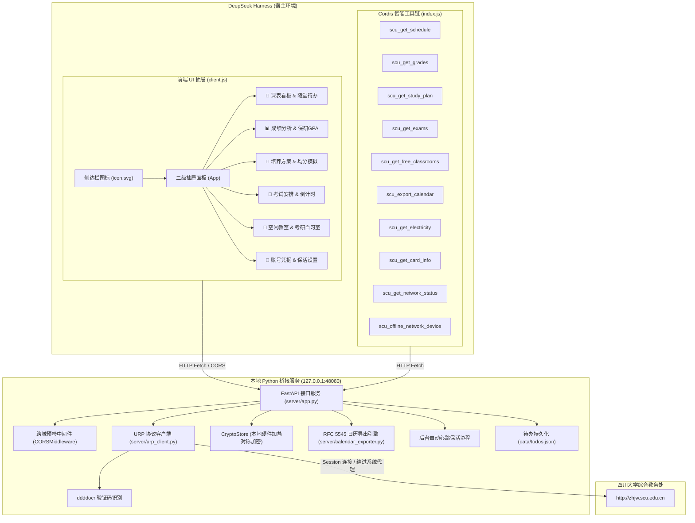

# DeepSeek Harness 四川大学教务系统 (URP) 插件

[](https://github.com/deepseek-ai)
[](https://cordis.moe)
[](https://github.com/AR-26710-1/dsh-plugin-scu-urp)
[](LICENSE)

> 💡 **AI 原生创作声明**：本项目由人类开发者与 **Google Antigravity + Gemini 3.8 Flash** 结对协同深度创作（Co-created with AI），全方位覆盖底层协议逆向、国密算法实现、全栈自愈容灾、SWR 高性能前端架构与独立免安装程序构建。

基于 **DeepSeek Harness (DSH)** 官方插件体系与四川大学综合教务系统（URP）逆向协议打造。为川大学生提供**左侧二级抽屉可视化看板**与**对话 Agent 双模联动**的高颜值智慧教务体验。

---

## 🌟 核心功能一览

### 1. 📅 现代化高颜值课表 & 手机日历同步
- **日历网格 / 日程清单双模**：周次切换（1~20周或全学期），今日课程自动高亮。
- **川大官方作息时间对齐**：区分**望江/华西校区**与**江安校区**双校区作息表，显示分钟级精确起止时间。
- **系统日历一键导出 (.ics)**：支持导出 RFC 5545 标准日历文件，适配 iOS、小米、华为、OPPO、vivo、Google Calendar 等，内置课前 15 分钟提醒。
- **线上修读专区**：未排固定教室的线上网课单独归集，避免遗漏。

### 2. 📝 课程随堂备忘与作业待办系统
- **课程卡片动态角标**：有未完成待办事项的课程，卡片右上角直观展示徽章提示（如 `1待办`）。
- **课程内独立管理**：点击课程卡片直接添加作业要求或备忘笔记，支持一键勾选完成（打勾划线）与删除。
- **全学期作业总览抽屉**：顶部常驻【作业待办】入口，一键汇总全学期所有课程任务，支持按“全部/待完成/已完成”筛选与统一打理。
- **双重本地持久化**：`localStorage` 与后端 `data/todos.json` 双向同步，数据永不丢失。

### 3. 🎯 培养方案全景大纲与未来均分/GPA预测模拟器 (What-If Simulator)
- **官方培养方案智能大纲**：自动逆向对齐学生所在院系、年级与专业培养方案大纲（如强基计划 165.0 毕业要求总学分），清晰展示当前毕业学分完成进度条。
- **三态课程全景穿透**：
  - **已修已出分课程**：基准均分与等级绩点清晰归档；支持勾选“假设刷分”模拟重修对分数的拉动效果。
  - **在读修读中课程**：自动带入测算模型，支持滑块拖拽或输入框打字修改预期成绩。
  - **方案待修读课程**：大三、大四待修课程一览无余，支持“+ 加入模拟测算”前瞻未来均分。
- **双轨均分与 GPA 实时动态联动**：
  - 实时联动计算**未来预期总加权均分**与**未来保研必修均分**；
  - 自动呈现 $\pm\Delta$ 变动徽章，直观展示相比已修历史分数的拉升或下拉趋势；
  - 提供 80/85/90/95 分一键批量预设、恢复默认与自选课程追加模拟。

### 4. 📊 成绩绩点与保研必修加权分析
- **加权 GPA 与均分自动核算**：五级等级制（A/A-/B+...）与百分制双轨折算。
- **保研口径一键切换**：自由在“全部修读”与“必修成绩（保研标准）”之间切换，实时刷新加权 GPA。
- **成绩单 Excel/CSV 导出**：支持一键导出个人成绩单表格。

### 5. 🏫 空闲教室与考研自习室查询
- **双校区作息自适应联动**：望江（08:00起）与江安（08:15起）时刻表毫秒级自适应切换。
- **图形化多维时序筛选**：
  - 4 个大时段 Pill：全天 (1~12节)、上午 (1~4节)、下午 (5~9节)、晚上 (10~12节)；
  - 12 个双行微型时间胶囊：上行第几节，下行时间点，高亮选中，并标记当前进行中节次。
- **1~12 节全天占用矩阵条**：清晰查看连续空闲节数、总座位容量、是否配有空调或研讨桌。

### 6. 🕒 考试日程与考场指引
- 期末与阶段性考试日程查询、倒计时天数提醒、具体考场校区、教学楼、考室号及个人座位号。

### 7. 📱 直接在 Harness 内微信/微川大扫码登录 (无需输密码)
- **Harness 原生扫码体验**：深度逆向川大官方竹云 IDaaS 统一身份认证，在面板内直接展示二维码，支持微信或微川大扫一扫免密授权。
- **长效凭证持久化与心跳保活**：扫码成功后，会话凭证基于本地硬件加密安全持久化，配合后台 10 分钟心跳保活协程，实现**长期免登录**，下次打开 Harness 直接 0ms 瞬开！
- **双模登录自由切换**：同时支持“学号密码账号登录”与“统一认证官网外部改密通道”，满足各类使用习惯。

### 8. ⚡ 会话自动心跳保活与极速秒开缓存
- **后台自动心跳保活 (Keep-Alive)**：后端每 10 分钟发送静默轻量探针，Session 超时自动重连，无需频繁输入密码登录。
- **Stale-While-Revalidate 秒开快照**：打开或切换 Tab 时 **0 毫秒首屏秒开**，后台静默增量刷新；断网或教务维护时优雅展示离线快照。

### 9. 🤖 对话 Agent 智能工具联动 (Cordis Tools)
主对话框输入自然语言即可自主唤醒 10 大核心工具：
- `scu_get_schedule`: 查课表与今日日程
- `scu_get_grades`: 查成绩、各学期统计与保研 GPA
- `scu_get_study_plan`: 查培养方案进度、毕业总学分与待修课程
- `scu_get_exams`: 查考试安排与考室座位
- `scu_get_free_classrooms`: 查指定校区、教学楼、时段空闲自习室
- `scu_export_calendar`: 导出全学期课表为手机日历文件 (.ics)
- `scu_get_electricity`: 查宿舍空调与照明实时剩余电费及房间位置
- `scu_get_card_info`: 查校园一卡通实体卡实时余额、今日支出与档口流水明细
- `scu_get_network_status`: 查校园网在线终端设备列表、并发连接配额与各设备 IP/MAC
- `scu_offline_network_device`: 远程下线指定校园网在线设备，释放 3 台并发连接限制

### 10. ⚡ 宿舍电费实时查询与换房绑定 (Electricity Suite)
- **双模电量实时感知**：一次查询同时获取宿舍的**【空调电费】**与**【照明电费】**实时剩余度数与单价。
- **全自动国密 SM2 登录**：深度对接竹云 IDaaS 统一身份认证，内置 SM2 动态非对称加密与本地神经网络验证码全自动秒级识别。
- **跨校区/跨楼栋换房支持**：支持交互式向导选择校区、楼栋、单元并切换任意宿舍电费。详细技术协议见 [ELECTRICITY_SPEC.md](ELECTRICITY_SPEC.md)。

---

## 🏗️ 架构概览



---

## 🚀 极速上手

### 1. 启动本地服务
在本项目根目录双击运行 `start.bat`，或在终端执行：
```bash
py -3.12 server/app.py
```
服务将在 `http://127.0.0.1:48080` 启动，并自动启动验证码 OCR 引擎与后台心跳保活机制。

### 2. 在 DeepSeek Harness 中使用
- 点击左侧常驻的**川大教务处**单色图标，即可展开现代化抽屉看板；
- 首次使用前往【账号与凭据】输入学号与综合教务密码并勾选“记住凭据”，即可开启全自动登录与会话保活；
- 点击【培养方案&均分测算】选项卡，即可实时滑动在读课程分数，前瞻毕业总均分与保研必修均分！

---

## 📦 独立免安装程序 (Standalone Service)
本项目支持一键编译为无需依赖任何 Python 环境的独立单文件服务：
- 构建脚本：`server/build_binary.py`
- 产物路径：`bin/scu-urp-service.exe`
- 运行机制：插件启动时将优先静默调用 `bin/scu-urp-service.exe`，实现 0 配置开箱即用。

---

## 🤖 AI 原生协同创作声明 (AI Co-Creation Statement)
本项目（`dsh-plugin-scu-urp`）属于 **AI 原生结对协同创作（AI-Crafted Application）**：
- **协同作者**：人类开发者（AR-26710-1）× Google Antigravity + Gemini 3.8 Flash 深度结对编程开发；
- **全栈技术链覆盖**：
  1. **协议逆向与国密安全**：深入川大竹云 IDaaS 统一身份认证与 URP 教务系统底层通信，实现动态国密 SM2/SM3 加密与离线验证码神经推理；
  2. **高性能前端交互**：单文件构建具备 Stale-While-Revalidate（SWR）毫秒级首屏秒开的高颜值 React 抽屉面板；
  3. **复杂学业算法模型**：首创针对培养方案的 What-If 动态均分/保研绩点测算引擎，支持双轨实时反馈；
  4. **工程化独立交付与环境自愈**：利用 PyInstaller 将庞大 Python 运行时与 3 大 ONNX 识别模型整合成 154MB 免安装独立二进制服务，并设计了 Python 解释器环境自愈启动链；
  5. **原创版权合规**：自主设计原创黑白简笔学术学位帽矢量图，遵循严格的 SPDX 开源规范。

---

## 📜 开源许可与第三方软件声明 (License & Notices)
- 本项目遵循 [MIT 许可证](LICENSE) 开源。
- 本项目使用的第三方开源组件、SPDX 许可证标识与官方仓库链接详见 [第三方软件声明 (THIRD_PARTY_NOTICES.md)](THIRD_PARTY_NOTICES.md)。
- **视觉图标说明**：为保障合规与知识产权尊重，开源发布版本已将官方校徽替换为完全原创的黑白简笔画学术学位帽矢量图标（`icon.svg` 与 UI 图标），不包含任何受保护的学校商标或专用标志。
- **免责声明**：本项目为第三方非官方效率辅助工具，仅供个人学习、研究与教务日常辅助使用。

