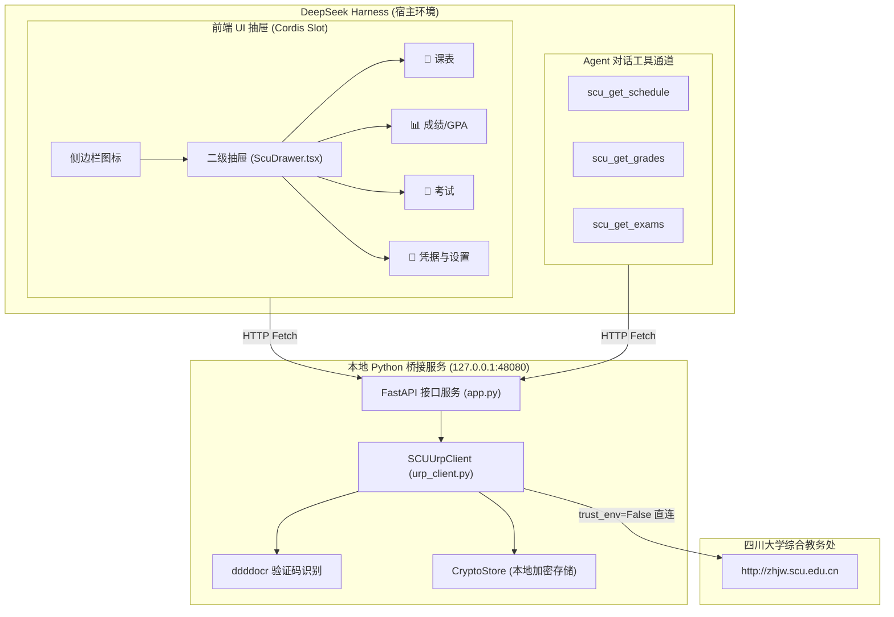

# DeepSeek Harness 四川大学教务系统 (URP) 插件

[](https://github.com/deepseek-ai)
[](https://cordis.moe)
[](LICENSE)

基于 **DeepSeek Harness (dsh)** 官方 Cordis 插件体系与四川大学综合教务系统（URP）逆向协议打造。为 DeepSeek Harness 客户端提供**左侧二级抽屉可视化看板**与**对话 Agent 双模联动**体验。

---

## 🌟 核心特性

- 🗂️ **左侧二级抽屉界面**：在 Harness 左侧边栏注入图标入口，点击流畅滑出抽屉面板（Drawer），不遮挡主对话区。
- 🔐 **自动登录与验证码 OCR**：
  - 本地懒加载 `ddddocr` 引擎识别 4 位验证码，内置重试容错（准确率 >95%）。
  - 双重 MD5 动态哈希计算。
  - 本地对称加密（Fernet）存储凭据，首次配置后即可一键/自动保活登录。
- 📅 **可视化课表看板**：
  - 支持“全部周课表”与“今日日程”一键切换。
  - 精准解析 **24 位周次位图字符串**（如第 1~16 周）。
  - 呈现教室、教学楼、起始节次、任课教师与学分。
- 📊 **成绩看板与 GPA 统计**：
  - 动态单次防重放 Token 自动提取。
  - 四川大学标准五级等级制（A/A-/B+...）与百分制 GPA 自动折算。
  - 加权平均分、已修总学分与分学期动态筛选。
- 📝 **考试日程倒计时**：
  - 期末与阶段性考试日程查询、考场地点与座位号显示。
- 🤖 **DeepSeek Agent 智能工具联动**：
  - 注册 `scu_get_schedule`、`scu_get_grades`、`scu_get_exams` 等 Cordis Tools。
  - 在主对话框问 *“帮我查下今天下午有课吗？”* 或 *“分析一下我上学期的 GPA 和成绩”*，模型可直接自主调用并给出建议。

---

## 🏗️ 架构概览



---

## 📁 目录结构

```text
dsh-plugin-scu-urp/
├── URP_API_SPEC.md              # 四川大学教务系统 (URP) 逆向接口规范文档
├── package.json                 # Cordis 插件配置与依赖
├── tsconfig.json                # TypeScript 编译配置
├── src/                         # 前端 UI 与 Cordis 插件逻辑
│   ├── index.ts                 # 插件入口：注册 Slot 与 Agent Tools
│   ├── tools/                   # Agent 对话工具定义
│   │   ├── schedule.ts          # 课表查询工具
│   │   ├── grades.ts            # 成绩/GPA 查询工具
│   │   └── exams.ts             # 考试安排工具
│   └── views/                   # 侧边栏抽屉 React 组件
│       ├── ScuDrawer.tsx        # 抽屉外层主容器
│       ├── components/
│       │   ├── ScheduleTab.tsx  # 课表网格与日程视图
│       │   ├── GradesTab.tsx    # 成绩卡片与 GPA 看板
│       │   ├── ExamsTab.tsx     # 考试安排卡片
│       │   └── LoginForm.tsx    # 学号/密码凭据输入界面
│       └── styles/
│           └── scu.css          # 川大专属风格样式表
├── server/                      # 本地 Python 桥接服务
│   ├── requirements.txt         # 服务端依赖
│   ├── app.py                   # FastAPI REST API 服务
│   ├── urp_client.py            # URP 协议封装客户端 (Session保活/重登)
│   └── crypto_store.py          # 本地凭据对称加密与持久化模块
├── .gitignore
└── README.md                    # 项目全套说明文档
```

---

## 🚀 快速开始

### 1. 启动本地 Python 桥接服务

进入 `server/` 目录并安装依赖：
```bash
cd server
pip install -r requirements.txt
python app.py
```
*服务将在 `http://127.0.0.1:48080` 启动，并监听状态请求。*

### 2. 编译与加载插件

在项目根目录下：
```bash
npm install
npm run build
```
随后在 DeepSeek Harness 的插件管理器或配置文件中加载本插件，或者作为本地开发插件符号链接到 Harness 的插件目录中。

---

## 💡 使用指南

1. **登录教务处**：
   - 点击 Harness 左侧边栏的 **SCU 图标**，二级抽屉滑出。
   - 首次打开时，在“设置”页中输入学号与密码，勾选“记住密码”。
   - 点击“立即登录”，后端自动获取验证码并通过 `ddddocr` 自动识别完成鉴权。
2. **快速查看课表/成绩/考试**：
   - 登录成功后，即可在顶部 Tab 自由切换：
     - **课表**：可查看全部周课表或一键查看“今日日程”。
     - **成绩**：自动展示平均学分绩点（GPA）与总学分，支持下拉选择指定学期筛选。
     - **考试**：展示即将进行的考试安排与考场座位。
3. **与 DeepSeek 对话交互**：
   - 在 DeepSeek 对话框输入：
     > *“帮我查下我这学期周一和周二有哪些课？”*
     > *“查一下我的综合 GPA 和成绩情况，帮我做个学分分析。”*
   - DeepSeek Harness 会自动调用本插件的 Agent Tools 获取实时数据并给出格式化回答。

---

## 🛡️ 安全与隐私

- **无第三方中转**：所有请求均为本地与四川大学官方教务系统（`zhjw.scu.edu.cn`）直连，不经过任何第三方服务器。
- **本地凭据加密**：凭据保存在本地系统中使用基于主机指纹的 Fernet 密钥对称加密存储，不存明文密码。
- **代理绕行保护**：客户端网络请求显式指定 `trust_env=False`，防止校园内网请求被科学上网代理工具劫持导致超时。

---

## 🤝 致敬开源

本项目设计与开发借鉴并参考了社区优秀的 SCU 校园开源实践：
- [Visio-Vanitas/scu-plus](https://github.com/Visio-Vanitas/scu-plus)（UI 风格与周次位图设计参考）
- [The-Brotherhood-of-SCU/SCU-CLI](https://github.com/The-Brotherhood-of-SCU/SCU-CLI)（命令行与接口容错设计参考）
