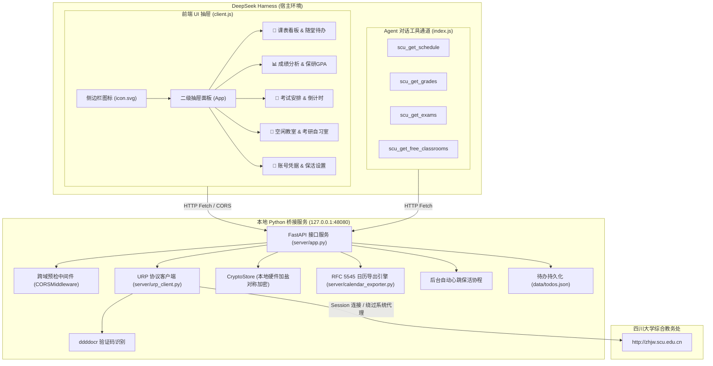

# DeepSeek Harness 四川大学教务系统 (URP) 插件

[](https://github.com/deepseek-ai)
[](https://cordis.moe)
[](LICENSE)

基于 **DeepSeek Harness (DSH)** 官方插件体系与四川大学综合教务系统（URP）逆向协议打造。为川大学生提供**左侧二级抽屉可视化看板**与**对话 Agent 双模联动**的高颜值智慧教务体验。

---

## 🌟 核心功能一览

### 1. 📅 现代化高颜值课表 & 手机日历同步
- **日历网格 / 日程清单双模**：周次切换（1~20周或全学期），今日课程自动高亮。
- **川大官方作息时间对齐**：区分**望江/华西校区**与**江安校区**双校区作息表，显示分钟级精确起止时间。
- **系统日历一键导出 (.ics)**：支持导出 RFC 5545 标准日历文件，适配 iOS、小米、华为、OPPO、vivo、Google Calendar 等，内置课前 15 分钟提醒。
- **线上修读专区**：未排固定教室的线上网课单独归集，避免遗漏。

### 2. 📝 课程随堂备忘与作业待办系统
- **课程卡片动态角标**：有未完成待办事项的课程，卡片右上角直观展示徽章提示（如 `1待办`）。
- **课程内独立管理**：点击课程卡片直接添加作业要求或备忘笔记，支持一键勾选完成（打勾划线）与删除。
- **全学期作业总览抽屉**：顶部常驻【作业待办】入口，一键汇总全学期所有课程任务，支持按“全部/待完成/已完成”筛选与统一打理。
- **双重本地持久化**：`localStorage` 与后端 `data/todos.json` 双向同步，数据永不丢失。

### 3. 🏫 空闲教室与考研自习室查询
- **双校区作息自适应联动**：望江（08:00起）与江安（08:15起）时刻表毫秒级自适应切换。
- **图形化多维时序筛选**：
  - 4 个大时段 Pill：全天 (1~12节)、上午 (1~4节)、下午 (5~9节)、晚上 (10~12节)；
  - 12 个双行微型时间胶囊：上行第几节，下行时间点，高亮选中，并标记当前进行中节次。
- **1~12 节全天占用矩阵条**：清晰查看连续空闲节数、总座位容量、是否配有空调或研讨桌。

### 4. 📊 成绩绩点与保研必修加权分析
- **加权 GPA 与均分自动核算**：五级等级制（A/A-/B+...）与百分制双轨折算。
- **保研口径一键切换**：自由在“全部修读”与“必修成绩（保研标准）”之间切换，实时刷新加权 GPA。
- **成绩单 Excel/CSV 导出**：支持一键导出个人成绩单表格。

### 5. 🕒 考试日程与考场指引
- 期末与阶段性考试日程查询、倒计时天数提醒、具体考场校区、教学楼、考室号及个人座位号。

### 6. ⚡ 会话自动心跳保活与极速秒开缓存
- **后台自动心跳保活 (Keep-Alive)**：后端每 10 分钟发送静默轻量探针，Session 超时自动重连，无需频繁输入密码登录。
- **Stale-While-Revalidate 秒开快照**：打开或切换 Tab 时 **0 毫秒首屏秒开**，后台静默增量刷新；断网或教务维护时优雅展示离线快照。

### 7. 🤖 对话 Agent 智能工具联动 (Cordis Tools)
主对话框输入自然语言即可自主唤醒工具：
- `scu_get_schedule`: 查课表与今日日程
- `scu_get_grades`: 查成绩、各学期统计与保研 GPA
- `scu_get_exams`: 查考试安排与考室座位
- `scu_get_free_classrooms`: 查指定校区、教学楼、时段空闲自习室

---

## 🏗️ 架构概览



---

## 📁 核心工程目录

详细工程架构设计请参阅：[PROJECT_STRUCTURE.md](file:///d:/antigravaty/scu教务处/PROJECT_STRUCTURE.md)。

```text
d:\antigravaty\scu教务处/
├── index.js                     # 插件顶层入口：向 DSH 注册 Slot 与 4 大 Agent Tools
├── client.js                    # 前端一体化单文件组件：全量 React UI、秒开缓存与自习室矩阵
├── icon.svg                     # 侧边栏常驻四川大学单色镂空矢量图标
├── package.json                 # Cordis 规范配置与依赖定义
├── start.bat                    # 本地 Python 后端极速启动批处理脚本
├── PROJECT_STRUCTURE.md         # 项目全套架构设计与技术实现说明书
├── URP_API_SPEC.md              # 四川大学综合教务处逆向接口协议手册
├── README.md                    # 本文档
│
├── server/                      # 本地 Python 桥接服务 (监听 127.0.0.1:48080)
│   ├── app.py                   # FastAPI 后端路由、CORS 中间件、心跳保活与待办持久化
│   ├── urp_client.py            # URP 核心协议类：验证码识别、加盐哈希、课表/成绩/自习室抓取
│   ├── crypto_store.py          # 本地凭据对称加密存储模块
│   ├── calendar_exporter.py     # RFC 5545 标准 iCalendar (.ics) 日历导出引擎
│   └── requirements.txt         # 服务端 Python 依赖清单
│
└── data/                        # 本地个人数据存储 (已加入 .gitignore，安全隔离)
    └── todos.json               # 课程随堂备忘录与作业待办数据
```

---

## 🚀 快速启动

### 1. 启动本地 Python 桥接服务

```bash
cd server
pip install -r requirements.txt
python app.py
```
*或直接双击根目录下的 `start.bat`。服务将在 `http://127.0.0.1:48080` 启动运行。*

### 2. 载入 DeepSeek Harness 插件

在 DeepSeek Harness 插件管理器中启用本插件，或配置在开发插件列表中。

---

## 🎨 视觉与交互规范

- **统一单色镂空图标**：彻底去除彩色 Emoji，全面统一为 Feather 规范单色镂空 SVG 简笔画图标。
- **亮暗主题双轨自适应**：原生适配 DSH 深色/浅色模式，莫兰迪配色护眼高质感。

---

## 🛡️ 安全与隐私

- **完全本地直连**：直接向川大官方教务系统（`zhjw.scu.edu.cn`）发起请求，无任何第三方云端中转服务器。
- **硬件加盐加密存储**：学号与密码采用基于主机硬件指纹的 Fernet 对称加密算法加密保存在本地 `.credentials.json` 中，严禁明文落地。
- **校园网代理防劫持**：显式配置 `trust_env=False`，防止内网流量被系统科学上网工具代理导致超时。
