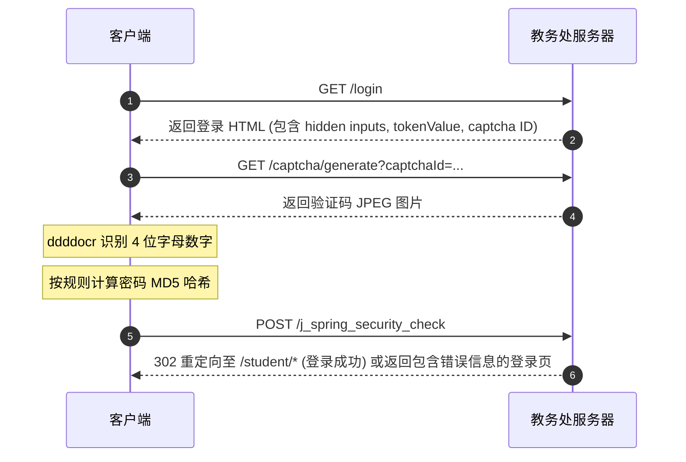
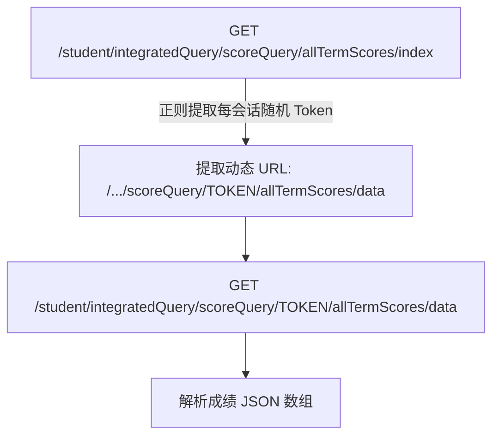

# 四川大学教务系统 (URP) 逆向接口规范与重构开发文档

> **文档版本**: 1.0.0  
> **基准系统**: `http://zhjw.scu.edu.cn` (综合教务系统)  
> **适用场景**: 平替教务系统客户端、轻量课表/成绩查询服务、自动化选课/自习室检索应用

---

## 1. 基础规范与网络要求

### 1.1 基础信息
* **Base URL**: `http://zhjw.scu.edu.cn`
* **字符编码**: 请求与响应均为 `UTF-8`（注：教务处少数旧服务端可能在异常时输出 GBK/HTML，解析时需兜底）。
* **网络环境**: 
  * 外网直连或通过 WebVPN。
  * **避坑要点**: 自动化脚本中强烈建议设置 `session.trust_env = False`，避免被本机系统代理（如科学上网工具）劫持导致校园网内网路由超时或拦截。

### 1.2 通用请求头
所有 JSON/AJAX 接口必须携带下列头部：
```http
User-Agent: Mozilla/5.0 (Windows NT 10.0; Win64; x64) AppleWebKit/537.36 (KHTML, like Gecko) Chrome/120.0.0.0 Safari/537.36
X-Requested-With: XMLHttpRequest
Referer: http://zhjw.scu.edu.cn/login
Content-Type: application/x-www-form-urlencoded; charset=UTF-8
```

---

## 2. 鉴权与登录机制 (Spring Security)

教务处使用魔改后的 Spring Security 流程，登录包含**动态表单解析、验证码 OCR、前端 JS 双重 MD5 计算**三步。



### 2.1 步骤 1：解析登录页
* **接口**: `GET /login`
* **解析字段**:
  1. **表单 Action**: 从 `<form action="...">` 获取，缺省为 `/j_spring_security_check`。
  2. **Hidden Inputs**: 提取表单中所有 `input[type="hidden"]` 字段。
  3. **Token 值**: 正则匹配 `tokenValue`：
     ```regex
     (?:name|id)=['"]tokenValue['"][^>]*value=['"]([^'"]+)['"]
     ```
  4. **验证码图片**: 提取 `img#captchaImg` 或相关标签中的验证码链接（通常形如 `/captcha/generate?captchaId=...`）。

### 2.2 步骤 2：验证码获取与识别
* **接口**: `GET /captcha/generate?captchaId=...`
* **识别方案**: 使用 `ddddocr` 识别。
  > [!TIP]
  > `ddddocr` 在 Python 初始化时会向 `sys.stdout` 输出打印字符，如果构建 MCP/CLI 工具，需重定向输出流至 `sys.stderr` 避免破坏标准输出通讯协议。

### 2.3 步骤 3：密码哈希计算
系统支持动态探测前端加密规则，标准计算逻辑为双重 MD5：
```python
import hashlib

def encrypt_password(password: str) -> str:
    # 第一层 MD5
    md5_once = hashlib.md5(password.encode('utf-8')).hexdigest()
    # 第二层 MD5
    md5_twice = hashlib.md5(md5_once.encode('utf-8')).hexdigest()
    return md5_twice
```
*注：部分老版本部署可能在前端带固定盐值，若双 MD5 报错，可在登录页抽取前端 `loginButton.onclick` 绑定的 JS 函数。*

### 2.4 步骤 4：提交登录表单
* **接口**: `POST /j_spring_security_check`
* **表单载荷**:
  ```python
  data = {
      "j_username": username,
      "j_password": encrypt_password(password),
      "j_captcha": captcha_code,
      "tokenValue": token_value,
      **hidden_inputs  # 合并所有页面 hidden 键值对
  }
  ```
* **登录成功判断**:
  * 响应状态码为 302 且重定向地址包含 `/student/`；
  * 或响应页面 HTML 中包含 `"退出系统"`。
* **错误识别**: 匹配页面文本中的 `"验证码错误"`、`"用户名或密码错误"`、`"token校验失败"`。

### 2.5 会话维持与自动重登
教务处 session（JSESSIONID）空闲超时通常为 20~30 分钟。在封装请求器时需实现透明拦截：
* 若响应包含重定向至 `/login` 或 HTTP 状态码为 `302`/`401`，判定为登录失效；
* 自动调用登录流程刷新 Session，并无缝重试上一次失败的请求。

---

## 3. 课表查询业务接口

### 3.1 提取当前学期编号
* **接口**: `GET /student/personalSenate/giveLessonInfo/thisSemesterSchedule/weekLySchedule`
* **解析字段**: 从响应 HTML 中匹配提取 `soliderboxval` 的属性值（当前学年参数，如 `7`）。
  ```regex
  soliderboxval[^>]*value="([^"]+)"
  ```

### 3.2 获取课表 JSON 数据
* **接口**: `GET /student/courseSelect/thisSemesterCurriculum/ajaxStudentSchedule/weekLySchedule/callback/{semester_id}`
* **响应格式**: JSON
* **关键字段结构**:
  * `dateList[]` -> `selectCourseList[]`: 课程明细数组。
    * `courseName`: 课程名称。
    * `coursePropertiesName`: 课程属性（必修/选修/通识）。
    * `attendClassTeacher`: 任课教师姓名。
    * `courseNumber`: 课程号。
    * `unitNumber`: 课序号。
    * `unitCredit`: 学分。
    * `timeAndPlaceList[]`: 上课时间与地点列表。

### 3.3 课表时间与地点解码规则
| 字段名 | 类型 | 说明与解码规则 |
| :--- | :--- | :--- |
| `classDay` | `int` | 星期（`1` 为周一，`7` 为周日） |
| `classSessions` | `int` | 当天起始节次（1-indexed，如 `1` 表示第 1 节课） |
| `continuingSession`| `int` | 持续节数（通常为 `2` 或 `3`） |
| `teachingBuildingName` | `str` | 教学楼名称（如 `综合楼C座`、`一教A座`） |
| `classroomName` | `str` | 教室号（如 `C-205`） |
| `classWeek` | `str` | **24 位周次位图字符串**：长度为 24 的 `0/1` 串，第 $i$ 位（0-indexed）为 `1` 代表第 $i+1$ 周有课。例如 `011111100...` 表示第 2~7 周上课。 |

---

## 4. 成绩查询业务接口

教务处的全部成绩接口使用了动态单次防重放 Token 机制。



### 4.1 步骤 1：获取动态数据路径
* **接口**: `GET /student/integratedQuery/scoreQuery/allTermScores/index`
* **解析字段**: 使用正则提取真实数据接口 URL：
  ```regex
  /student/integratedQuery/scoreQuery/([^/]+)/allTermScores/data
  ```
  > [!WARNING]
  > 该 Token 随页面访问动态生成，若直接复用历史 Token 会返回 `"非法请求"` 错误。

### 4.2 步骤 2：获取全量成绩列表
* **接口**: `GET /student/integratedQuery/scoreQuery/{token}/allTermScores/data`
* **响应格式**: JSON
* **核心字段字典**:
  | 字段键名 | 业务含义 | 示例值 |
  | :--- | :--- | :--- |
  | `KCM` | 课程名称 | `量子力学` |
  | `KCH` | 课程号 | `202052030` |
  | `KXH` | 课序号 | `01` |
  | `XF` | 学分 | `4.0` |
  | `KCCJ` | 成绩分数 | `92` / `优秀` |
  | `DJM` | 等级成绩 | `A` |
  | `ZXJXJHM`| 学期代码 | `2024-2025-1-1` |
  | `KCXZMC` | 课程性质 | `必修` |
  | `CJSM` | 成绩说明 | 正常/期末 |

---

## 5. 空闲教室与教学楼自习查询

### 5.1 获取校区与教学楼编号表
* **接口**: `GET /student/teachingResources/classroomUseStatus/index`
* **数据来源**: 页面预置 hidden input：
  * `#xqList`: 校区字典（`01` 望江, `02` 华西, `03` 江安）
  * `#jxlList`: 教学楼编号字典（如江安综合楼B座=`305`，一教A座=`301` 等）

### 5.2 教室占用状况查询
* **接口**: `POST /student/teachingResources/classroomUseStatus/jasInfo`
* **请求表单参数**:
  * `xqh`: 校区号（如 `03`）
  * `jxlh`: 教学楼编号（如 `305`）
  * `jslx`: 教室类型（留空默认全部）
  * `jasm`: 教室名称模糊匹配（如空查全楼）
  * `zwFrom` / `zwTo`: 座位数范围（可选）
  * `searchDate`: 查询日期（格式 `YYYY-MM-DD`，留空代表今天）

### 5.3 响应解析与状态码折算
* **返回 JSON 结构**:
  * `classrooms[]`: 教室元数据（`jash` 教室号, `placeNum` 座位数, `remark` 备注）。
  * `classroomTime[]`: 占用记录。
    * `id.xq`: 星期几（1-7）。
    * `id.week`: 24 位周次位图。
    * `id.sessionstart`: 占用起始节。
    * `continuingsession`: 持续节数。
    * `occupancymoduleId`: **占用原因模块 ID**（**判定占用类型的唯一准确字段**）：
      * `"06"`: 有课
      * `"07"`: 考试
      * `"14"`: 实验
      * `"room"`: 行政借用
    * `id.sessiontype`: `01` 上课 / `02` 考试。
      > [!IMPORTANT]
      > 当 `sessiontype == "02"`（考试）时，一节考试占用 2 个大节，且 `sessionstart` 为作息节次。必须使用响应中 `codeJclxdzb` 表（`xqdm == jhZxjxjhb.xqdm`）的 `ksjc -> skjc` 映射折算回普通上课节次。

---

## 6. 培养方案全量接口

适合构建选课培养计划平替或学分预警工具。

### 6.1 方案列表查询
* **接口**: `POST /student/comprehensiveQuery/search/trainProgram/load`
* **参数**:
  * `pageNum`: 页码
  * `pageSize`: 每页条数（如 50）
  * `xsh`: 学院号（如物理学院 `202`）
  * `nj`: 年级（如 `2025`）
  * `famc`: 方案名称（支持模糊匹配）
* **返回**: 包含全校 5000+ 培养方案 records（方案号 `FAJHH`、方案名称 `FAMC`、专业 `ZYM` 等）。

### 6.2 方案树形大纲
* **接口**: `POST /student/comprehensiveQuery/search/trainProgram/detail`
* **参数**: `fajhh={方案号}&lx=1`（`lx=1` 必传，缺省报 400）。
* **返回**: 方案总学分、修读要求与分类树（`treeList`）。叶子节点带有课程明细路径 `urlPath`：
  `/student/comprehensiveQuery/search/trainProgram/info2/<fajhh>@<jhkch>`

### 6.3 课程大纲详情
* **接口**: `GET /student/comprehensiveQuery/search/trainProgram/info2/{fajhh}@{jhkch}`
* **返回**: 课程中英文名称、学分学时、师资团队（`szdw`）、课程简介（`nrjj`）、教学大纲（`jxdg`）、考核方式（`kslxmc`）、建议开课学期（`jhkc.xqm`）。

---

## 7. 考试安排日程

* **日历查询**: `GET /student/examinationManagement/examPlan/detail?start={YYYY-MM-DD}&end={YYYY-MM-DD}`
* **要求**: 必须带 `X-Requested-With: XMLHttpRequest`。
* **返回**: 考试日程 JSON。若当前区间无考试，服务端返回 `{"status": "203"}`。

---

## 8. Python 最小客户端脚手架代码

以下代码提供了一个开箱即用的轻量级 Session 客户端，具备透明重登与鉴权封装：

```python
import re
import hashlib
import requests
import ddddocr

class SCUUrpClient:
    BASE_URL = "http://zhjw.scu.edu.cn"
    
    def __init__(self, username: str, password: str):
        self.username = username
        self.password = password
        self.session = requests.Session()
        self.session.trust_env = False  # 防系统代理劫持
        self.ocr = ddddocr.DdddOcr(show_ad=False)
        self.headers = {
            "User-Agent": "Mozilla/5.0 (Windows NT 10.0; Win64; x64) Chrome/120.0.0.0 Safari/537.36",
            "X-Requested-With": "XMLHttpRequest",
            "Referer": f"{self.BASE_URL}/login"
        }

    @staticmethod
    def _encrypt_password(password: str) -> str:
        first = hashlib.md5(password.encode('utf-8')).hexdigest()
        return hashlib.md5(first.encode('utf-8')).hexdigest()

    def login(self) -> bool:
        """执行教务处登录流程"""
        resp = self.session.get(f"{self.BASE_URL}/login", headers=self.headers, timeout=15)
        html = resp.text
        
        # 1. 提取 tokenValue 与 hidden 字段
        token_match = re.search(r"name=['"]tokenValue['"][^>]*value=['"]([^'"]+)['"]", html)
        token_value = token_match.group(1) if token_match else ""
        
        # 2. 获取并识别验证码
        captcha_resp = self.session.get(f"{self.BASE_URL}/captcha/generate?_={resp.cookies.get('JSESSIONID')}", timeout=15)
        captcha_code = self.ocr.classification(captcha_resp.content)
        
        # 3. 提交登录
        payload = {
            "j_username": self.username,
            "j_password": self._encrypt_password(self.password),
            "j_captcha": captcha_code,
            "tokenValue": token_value
        }
        login_resp = self.session.post(f"{self.BASE_URL}/j_spring_security_check", data=payload, headers=self.headers, timeout=15)
        
        return "退出系统" in login_resp.text or "/student/" in login_resp.url

    def request(self, method: str, path: str, **kwargs) -> requests.Response:
        """带自动重连的请求封装"""
        url = path if path.startswith("http") else f"{self.BASE_URL}{path}"
        resp = self.session.request(method, url, headers=self.headers, **kwargs)
        
        # 检测会话失效
        if "/login" in resp.url or resp.status_code in (302, 401):
            if self.login():
                resp = self.session.request(method, url, headers=self.headers, **kwargs)
            else:
                raise RuntimeError("教务系统登录凭证失效且重登失败")
        resp.raise_for_status()
        return resp

    def get_schedule(self) -> dict:
        """拉取个人课表 JSON"""
        page = self.request("GET", "/student/personalSenate/giveLessonInfo/thisSemesterSchedule/weekLySchedule").text
        sem = re.search(r'soliderboxval[^>]*value="([^"]+)"', page).group(1)
        return self.request("GET", f"/student/courseSelect/thisSemesterCurriculum/ajaxStudentSchedule/weekLySchedule/callback/{sem}").json()

    def get_grades(self) -> dict:
        """拉取全量成绩 JSON"""
        page = self.request("GET", "/student/integratedQuery/scoreQuery/allTermScores/index").text
        token = re.search(r"/scoreQuery/([^/]+)/allTermScores/data", page).group(1)
        return self.request("GET", f"/student/integratedQuery/scoreQuery/{token}/allTermScores/data").json()
```
