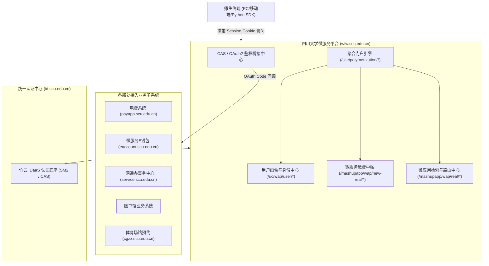

# 四川大学微服务平台 (WFW) — 架构解析与接口规范说明书

本文档用于完整记录**四川大学微服务平台（`wfw.scu.edu.cn`）**及其**聚合门户（Polymerization Homepage）**的系统架构、数据格式、通信协议、功能全景及全量核心 API 清单，便于后续工程化接入。

---

## 1. 系统概览与枢纽地位

四川大学微服务平台（`wfw.scu.edu.cn`）是全校师生移动端与 Web 端的**核心业务聚合中枢**。它集成了全校各部处（教务处、学工部、保卫处、后勤保障部、信息中心、图书馆、财务处等）的微应用，同时作为 **OAuth2 授权服务提供商**，为外部子系统（如电费系统 `payapp.scu.edu.cn`、E钱包 `eaccount.scu.edu.cn` 等）提供免密单点登录票据转接。



---

## 2. 鉴权机制与请求/响应规范

### 2.1 会话鉴权 Cookie
微服务平台所有业务请求均依赖以下核心 Cookie（同属 `wfw.scu.edu.cn` 域）：
* `eai-sess`: 微服务平台的 PHP/Web 会话 Session ID。
* `UUkey`: 用户持久化唯一标识。
* 若未登录或会话失效，接口返回 `{"e": 10013, "m": "请先登录"}`，前端将自动重定向至：
  `https://wfw.scu.edu.cn/a_scu/api/cas/login?redirect=...`，走统一身份认证重新登录。

### 2.2 统一响应数据结构
微服务平台绝大多数接口均遵循标准 JSON 响应协议：
```json
{
  "e": 0,           // 状态码：0 代表成功，非 0 代表失败 (如 10013 为未登录)
  "m": "操作成功",   // 提示信息说明
  "d": { ... }      // 实际业务数据体 (Object 或 Array)
}
```

### 2.3 核心请求头规范
```http
User-Agent: Mozilla/5.0 (Windows NT 10.0; Win64; x64) AppleWebKit/537.36 ...
X-Requested-With: XMLHttpRequest
Accept: application/json, text/plain, */*
```

---

## 3. 全景功能地图与微应用分类 (共 72+ 个服务)

四川大学聚合门户按业务域划分为 **9 大板块**，共汇聚了 72 个重点微应用：

### 3.1 常用功能 (Common)
* **云上川大校园导览** (`https://3d.scu.edu.cn/`)
* **体质测试** (`https://pead.scu.edu.cn/...`)
* **英语竞赛报名** (`https://dangfei.scu.edu.cn/apply/quietLogin`)
* **我的申请 / 在线审批 / 我的审核** (`https://service.scu.edu.cn/newservice/fe/taskCenter/...`)
* **校园卡充值** (`https://payapp.scu.edu.cn/rfid/views/index.html`)
* **学生返校报备系统** (`app_id=595`)

### 3.2 日常管理专栏 (Daily)
* **离校/不在校请假** (`https://wfw.scu.edu.cn/site/applicationSquare/index?sid=5`)
* **假期留校学生离校报备** (成都市外/当天不能回校)
* **因病缺勤登记** (`app_id=596`)
* **非本校人员信息录入** (`sid=21`)

### 3.3 校园生活服务 (Campus Life)
* **体育场馆预约** (`http://cgzx.scu.edu.cn/venue/`)
* **心理健康与 AI心晴** (`http://xlyz.scu.edu.cn/` / `lingxinai.com`)
* **校车时刻表** (`https://wfw.scu.edu.cn/wap/material?id=557`)
* **后勤服务与报修平台** (`https://zhhq.scu.edu.cn/loginapp` / `sid=19`)
* **第二课堂成绩单** (`https://dekt.scu.edu.cn/...`)
* **来访人员进校预约** (`http://visitor.scu.edu.cn/...`)
* **校园高精度三维导航** (`https://gis.scu.edu.cn/cmipsh5/#/`)
* **校历与学校重要公告** (`tzgg.htm` / `id=556`)

### 3.4 校园卡服务 (Campus Card)
* **校园卡在线充值** (`payapp.scu.edu.cn/rfid/views/index.html`)
* **校园卡交易明细流水** (`/site/idCard/history`)
* **一卡通一键挂失** (`/rfid/views/loss-index.html`)
* **校园失物招领** (`/site/found/index?tabIdx=1`)

### 3.5 校园网服务 (Network)
* **个人缴网费 / 内转网费** (`payapp.scu.edu.cn/net_fee` / `net_account`)
* **校园网套餐在线变更** (`payapp.scu.edu.cn/net_fee_change`)
* **在线终端管理与下线** (`/site/network/device`)
* **无感设备 MAC 绑定 / 运营商账号绑定** (`service.scu.edu.cn/...`)
* **统一密码修改重置** (`/site/polymerization/modifyPass`)

### 3.6 教学科研 (Teaching & Research)
* **学生课表** (`/site/weekschedule/index`)
* **我的图书馆 / 图书检索 / 借阅历史** (`/site/library/mine`, `/collection`, `/history`)
* **成绩查询** (`/site/score/index`)
* **空闲自习教室与研讨室** (`http://cir.scu.edu.cn/cir/index.html`)
* **大川学堂 / 数字党校 / 学术看板**

### 3.7 支付与缴费专区 (Payment Hub)
* **宿舍空调充值** (`https://payapp.scu.edu.cn/eleFees/oauth/airWarrant`)
* **宿舍照明充值** (`https://payapp.scu.edu.cn/eleFees/oauth/lightWarrant`)
* **校园卡充值 / 网费充值**
* **多校区停车缴费** (望江/华西/材料大楼/博士楼/物理馆/月租车证)
* **证书证件补办 / 居民水电气缴费** (`shoufei.scu.edu.cn/...`)
* **党费与工会会费缴纳** (`dangfei.scu.edu.cn/...`)

### 3.8 就业创业服务 (Career)
* **就业手续在线办理** (`http://jy.scu.edu.cn/...`)
* **校园招聘会 / 宣讲会 / 职位双选会检索**
* **就业政策资讯与一对一指导**

### 3.9 办公管理与资助
* **生源地助学贷款回执 / 校园地贷款验证码采集** (`formid=127` / `formid=273`)
* **法人证书与因公出国境审批** (`noa.scu.edu.cn/...`)

---

## 4. 核心 REST API 规范清单

基础域名：`https://wfw.scu.edu.cn`

### 4.1 用户画像与身份接口
* **接口路径**：`GET /uc/wap/user/get-info`
* **功能说明**：获取当前登录学生的学号、真实姓名、学院、身份、联系方式与权限。
* **响应结构示例**：
  ```json
  {
    "e": 0,
    "m": "操作成功",
    "d": {
      "base": {
        "uid": 5587956,
        "realname": "白镇萍",
        "sex": "男",
        "mobile": "19981527135",
        "email": "3031591408@qq.com",
        "role": {
          "number": "2024141470117",
          "identity": "本科生",
          "identity_id": 42
        },
        "departs": { "60": "物理学院" }
      }
    }
  }
  ```

### 4.2 聚合门户首页完整数据 (包含全部分类与微应用)
* **接口路径**：`GET /mashupapp/wap/real/home`
* **功能说明**：获取聚合首页所有板块、分类应用列表、轮播图与个人常用推荐。
* **响应核心字段**：
  * `d.banners`: 顶部大图轮播数组（含标题与跳转链接）。
  * `d.category`: 9 大分类数组，每个分类含 `name`、`apps`（每个 app 含 `id`, `name`, `pic`, `link`）。
  * `d.commonly`: 个人置顶的常用微应用列表。

### 4.3 支付与缴费专区接口
* **接口路径**：`GET /mashupapp/wap/new-real/pay-home`
* **功能说明**：获取学校所有缴费应用清单（水电费、网费、停车费、党费等）。
* **响应核心字段**：
  * `d.apps`: 缴费项目数组（包含名称、跳转认证链接 `link`）。

### 4.4 全校微应用搜索接口
* **接口路径**：`GET /mashupapp/wap/real/search?keyword={关键词}`
* **请求示例**：`GET /mashupapp/wap/real/search?keyword=电费`
* **响应核心字段**：
  * `d.list`: 匹配的应用列表，包含 `id`, `name`, `link`, `pic`, `rules`。

### 4.5 常用应用收藏与移除接口
* **添加常用**：`POST /mashupapp/wap/real/add-commonly`
  * Body: `{"id": "应用ID"}`
* **移除常用**：`POST /mashupapp/wap/real/delete-commonly`
  * Body: `{"id": "应用ID"}`

### 4.6 校园卡失物招领接口
* **接口路径**：`GET /cardlost/wap/default/info`
* **功能说明**：拉取全校最新捡拾到的校园卡招领列表（包含卡号、捡拾地点、登记时间）。

---

## 5. 快速接入 Python 示例代码

```python
import requests
import json

class SCUMicroServiceClient:
    def __init__(self, cookies_dict: dict):
        self.session = requests.Session()
        self.session.headers.update({
            "User-Agent": "Mozilla/5.0 (Windows NT 10.0; Win64; x64) AppleWebKit/537.36 ...",
            "X-Requested-With": "XMLHttpRequest"
        })
        self.session.cookies.update(cookies_dict)
        self.base_url = "https://wfw.scu.edu.cn"

    def get_user_profile(self) -> dict:
        """获取当前学生全量画像"""
        r = self.session.get(f"{self.base_url}/uc/wap/user/get-info")
        return r.json().get("d", {}).get("base", {})

    def get_all_services(self) -> list:
        """获取聚合门户 9 大分类下的全部微应用"""
        r = self.session.get(f"{self.base_url}/mashupapp/wap/real/home")
        return r.json().get("d", {}).get("category", [])

    def search_service(self, keyword: str) -> list:
        """全局搜索微服务应用"""
        r = self.session.get(f"{self.base_url}/mashupapp/wap/real/search", params={"keyword": keyword})
        return r.json().get("d", {}).get("list", [])

    def get_payment_apps(self) -> list:
        """获取缴费专区的所有项目"""
        r = self.session.get(f"{self.base_url}/mashupapp/wap/new-real/pay-home")
        return r.json().get("d", {}).get("apps", [])
```
